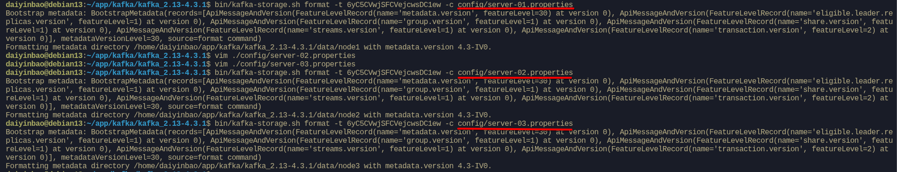
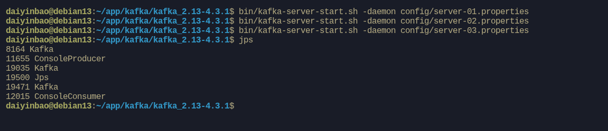
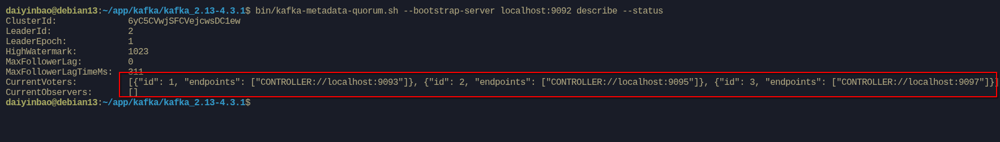
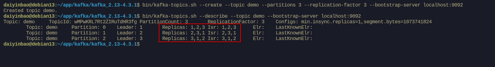
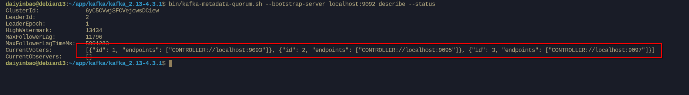
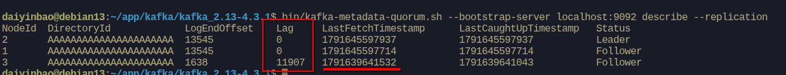
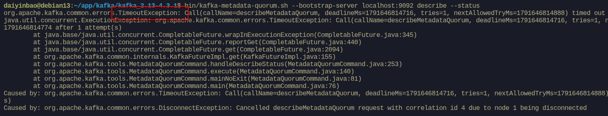

+++
title = "Kafka 的整体架构与 KRaft 模式"
date = 2026-10-09T15:31:52+08:00
weight = 11
tags = ["Kafka", "KRaft", "集群", "运维"]
summary = "Kafka 系列（二）：从单机走向集群，讲清 Broker、Controller、Metadata 的角色，以及 KRaft 模式与 controller quorum 的工作原理。"

+++

本篇是《kafka的快速入门》的后续。入门里我们只用了默认配置启动一个单机 Kafka，这一篇我们把进程拆开，讲清它内部都有哪些角色，并动手搭一个多节点的 KRaft 集群。

## 一、从单机进程说起

快速入门里，我们启动 Kafka 其实只用了两条命令：先初始化存储目录，再启动服务。一个 Kafka 进程看起来只是一个普通的 Java 服务，但如果把它拆开看，里面其实包含了几个不同的角色。

- **Broker**：真正负责存储消息、处理生产者和消费者请求的组件。
- **Controller**：负责管理集群的元数据，比如有哪些 Topic、每个分区的 Leader 是谁、某个 Broker 下线后怎么处理。
- **Metadata**：集群的"账本"，记录了 Topic、分区、副本、配置等信息。

在快速入门用的单机配置里，这几个角色其实都在同一个进程里，这叫 combined 模式，对应配置项 `process.roles=broker,controller`。生产环境更常见的做法，是把 Controller 单独拆出来，组成一个小的仲裁集群。

## 二、为什么要用 KRaft

早期版本的 Kafka 依赖 ZooKeeper 保存元数据，Controller 也是通过 ZooKeeper 选举出来的。这种架构有几个明显的麻烦：

- 要同时运维 Kafka 和 ZooKeeper 两套系统。
- 元数据放在 ZooKeeper 里，分区数量一多，Controller 启动时加载元数据会很慢。
- Controller 故障切换依赖 ZooKeeper 的选举，恢复时间比较长。

Kafka 从 3.3 开始正式提供 KRaft 模式，用 Raft 协议把元数据管理内置到 Kafka 自己内部，不再需要 ZooKeeper。到了 Kafka 4.0，ZooKeeper 模式已经被移除，KRaft 成为唯一的元数据管理方式。这也是快速入门里，我们用默认配置就能启动、完全不用管 ZooKeeper 的原因。

KRaft 的核心思路是：把元数据也当成一条日志。集群里的元数据变更（建 Topic、改配置、选 Leader 等）都会被追加到一个内部主题 `__cluster_metadata` 中，由 Controller 负责写入，其他节点跟随同步。既然是一份日志，就可以像消息一样被复制和回放。

## 三、controller quorum 与多数派

负责管理元数据的一组 Controller，称为 controller quorum（仲裁组）。它的成员在配置项 `controller.quorum.voters` 里声明：

```properties
controller.quorum.voters=1@localhost:9093,2@localhost:9095,3@localhost:9097
```

格式是 `node.id@host:port`。这几个 Controller 里，会有一个被选为 active controller，其余的作为 follower。所有元数据写入都先经过 active controller，再由它复制给其他成员。

这里的关键是"多数派"：任何一次元数据变更，都需要超过半数的成员确认，才算提交。

- 3 个成员：能容忍 1 个故障（剩下 2 个仍然是多数）。
- 5 个成员：能容忍 2 个故障。

所以 Controller 的数量一般取奇数（3 或 5）。2 个和 1 个的容错能力其实一样，4 个和 3 个也一样，多出来的成员并不能提升容错，反而增加同步开销。

## 四、实验：搭一个 3 节点 KRaft 集群

下面我们在 Debian 13 上，用同一台机器启动 3 个 Kafka 节点，组成一个最小的 KRaft 集群。

> 单机多进程只是为了方便演示。生产环境应该把 3 个节点部署在不同的机器上，否则机器一挂，多数派也就没了。

### 1、生成 cluster id

三个节点必须使用同一个 cluster id：

```bash
daiyinbao@debian13:~/app/kafka/kafka_2.13-4.3.1$ bin/kafka-storage.sh random-uuid
xtzWWN4bTjitpL3kfd9s5g
```


### 2、准备 3 份配置

```bash
daiyinbao@debian13:~/app/kafka/kafka_2.13-4.3.1$ cp config/server.properties config/server-1.properties
daiyinbao@debian13:~/app/kafka/kafka_2.13-4.3.1$ cp config/server.properties config/server-2.properties
daiyinbao@debian13:~/app/kafka/kafka_2.13-4.3.1$ cp config/server.properties config/server-3.properties
```

然后分别修改这几项，其余保持默认即可。

`config/server-1.properties`：

```properties
process.roles=broker,controller
node.id=1
controller.quorum.voters=1@localhost:9093,2@localhost:9095,3@localhost:9097
listeners=PLAINTEXT://:9092,CONTROLLER://:9093
advertised.listeners=PLAINTEXT://localhost:9092
log.dirs=/home/daiyinbao/app/kafka/kafka_2.13-4.3.1/data/node1
```

`config/server-2.properties`：

```properties
process.roles=broker,controller
node.id=2
controller.quorum.voters=1@localhost:9093,2@localhost:9095,3@localhost:9097
listeners=PLAINTEXT://:9094,CONTROLLER://:9095
advertised.listeners=PLAINTEXT://localhost:9094
log.dirs=/home/daiyinbao/app/kafka/kafka_2.13-4.3.1/data/node2
```

`config/server-3.properties`：

```properties
process.roles=broker,controller
node.id=3
controller.quorum.voters=1@localhost:9093,2@localhost:9095,3@localhost:9097
listeners=PLAINTEXT://:9096,CONTROLLER://:9097
advertised.listeners=PLAINTEXT://localhost:9096
log.dirs=/home/daiyinbao/app/kafka/kafka_2.13-4.3.1/data/node3
```

几个配置的含义：

- `node.id`：每个节点唯一，集群里不能重复。
- `listeners`：节点监听的地址。`PLAINTEXT` 给客户端用，`CONTROLLER` 给 Controller 之间通信使用，两套端口要分开。
- `advertised.listeners`：对外暴露的地址，客户端实际连接的就是它。
- `log.dirs`：数据目录，三个节点必须指向不同的目录，否则会互相覆盖。

### 3、分别格式化存储目录

```bash
daiyinbao@debian13:~/app/kafka/kafka_2.13-4.3.1$ bin/kafka-storage.sh format -t xtzWWN4bTjitpL3kfd9s5g -c config/server-1.properties
daiyinbao@debian13:~/app/kafka/kafka_2.13-4.3.1$ bin/kafka-storage.sh format -t xtzWWN4bTjitpL3kfd9s5g -c config/server-2.properties
daiyinbao@debian13:~/app/kafka/kafka_2.13-4.3.1$ bin/kafka-storage.sh format -t xtzWWN4bTjitpL3kfd9s5g -c config/server-3.properties
```



### 4、启动 3 个节点

```bash
daiyinbao@debian13:~/app/kafka/kafka_2.13-4.3.1$ bin/kafka-server-start.sh -daemon config/server-1.properties
daiyinbao@debian13:~/app/kafka/kafka_2.13-4.3.1$ bin/kafka-server-start.sh -daemon config/server-2.properties
daiyinbao@debian13:~/app/kafka/kafka_2.13-4.3.1$ bin/kafka-server-start.sh -daemon config/server-3.properties
```



## 五、验证：集群是否正常

### 1、查看 controller quorum

```bash
daiyinbao@debian13:~/app/kafka/kafka_2.13-4.3.1$ bin/kafka-metadata-quorum.sh --bootstrap-server localhost:9092 --describe --status
```



`LeaderId` 就是当前的 active controller。三个节点都在 `CurrentVoters` 里，说明 quorum 是完整的。

### 2、确认节点都在

```bash
daiyinbao@debian13:~/app/kafka/kafka_2.13-4.3.1$ bin/kafka-broker-api-versions.sh --bootstrap-server localhost:9092 | grep "id:"
```

应该能看到 3 个 broker id（1、2、3）。

### 3、创建带副本的 Topic

```bash
daiyinbao@debian13:~/app/kafka/kafka_2.13-4.3.1$ bin/kafka-topics.sh --create --topic demo --partitions 3 --replication-factor 3 --bootstrap-server localhost:9092
```

查看详情：

```bash
daiyinbao@debian13:~/app/kafka/kafka_2.13-4.3.1$ bin/kafka-topics.sh --describe --topic demo --bootstrap-server localhost:9092
```

输出大致如下：



可以看到，3 个分区的 Leader 分别落在 3 个节点上，每个分区都有 3 份副本（`Replicas`），并且都在 ISR 里。

### 4、停掉一个节点，观察 quorum

先找到 node3 对应的进程：

```bash
daiyinbao@debian13:~/app/kafka/kafka_2.13-4.3.1$ ps -ef | grep server-3.properties | grep -v grep
```

把它的 PID kill 掉：

```bash
daiyinbao@debian13:~/app/kafka/kafka_2.13-4.3.1$ kill -9 <node3的PID>
```

这时如果再用 `--describe --status` 去看：

```bash
daiyinbao@debian13:~/app/kafka/kafka_2.13-4.3.1$ bin/kafka-metadata-quorum.sh --bootstrap-server localhost:9092 --describe --status
```

会发现 `CurrentVoters` **仍然是 3 个成员**，一个都没少。



  `--status` 的含义：它输出的 `CurrentVoters` 来自配置文件里的 `controller.quorum.voters`，也就是**静态配置的成员列表**，并不是"当前还活着的成员"。所以节点被 kill 之后，这个列表不会发生变化。

想观察节点是否真的掉线，应该用 `--describe --replication`：

```bash
daiyinbao@debian13:~/app/kafka/kafka_2.13-4.3.1$ bin/kafka-metadata-quorum.sh --bootstrap-server localhost:9092 describe --replication
```

输出大致如下：



可以看到 node3 的 `LogEndOffset` 停在掉线前的位置，`LastFetchTimestamp` 也不再更新

这里的 `--bootstrap-server` 需要指向一个**还活着的节点**。本例三个节点都是 `broker,controller` 混部，node3 是 9096，只要不把它作为 bootstrap 入口，用 `localhost:9092`（node1）查询就没有问题。

虽然 node3 掉线了，但 3 个 controller 里还剩 2 个，仍然满足多数派（2 > 3/2），所以集群依然可以正常写入元数据，也能继续创建 Topic、修改配置。这正好对应前面说的"3 个容忍 1 个故障"。

如果再把第二个节点也停掉，就只剩 1 个 controller，凑不齐多数派（需要超过半数，也就是至少 2 个），集群会拒绝一切元数据变更。

这时如果直接执行创建 Topic：

```bash
daiyinbao@debian13:~/app/kafka/kafka_2.13-4.3.1$ bin/kafka-topics.sh --create --topic demo2 --partitions 1 --replication-factor 1 --bootstrap-server localhost:9092
```

会发现命令**一直卡住、没有任何输出**。这不是命令失效，而是客户端在反复重试：元数据写入需要多数派确认，而现在凑不齐多数派，请求既提交不了、也拿不到成功响应，于是就一直等下去。



这个 `TimeoutException` 才是"多数派丢失、元数据不可写"的真实表现。

## 六、部署与运维要点

- 生产环境建议把 Controller 和 Broker 分开部署，Controller 用 3 或 5 台独立的小规格机器。
- 各节点的 `log.dirs`、`listeners` 一定要区分开，端口不要冲突。
- 用 systemd 托管 Kafka 进程，比 `-daemon` 更可靠，方便开机自启和故障重启。
- 启动失败时，先看 `log.dirs` 下的 `server.log`，常见原因是：cluster id 不一致、端口被占用、`controller.quorum.voters` 写错。

## 小结

这一篇我们从"一个 Kafka 进程里有什么"出发，讲清了 Broker、Controller、Metadata 的角色，以及 KRaft 用元数据日志替代 ZooKeeper 的思路，并用一个 3 节点集群实际观察了 controller quorum 和多数派容错。

下一篇，我们会打开 `log.dirs`，看看 Topic 和分区在磁盘上到底长什么样，再顺着副本机制，走一遍生产者写入消息的全过程。
