+++
title = "kafka的快速入门"
date = 2026-10-06T23:35:25+08:00
weight = 10
tags = ["Kafka", "MQ", "消息队列", "运维"]
summary = "Kafka 快速入门（一）：从 MQ 的作用讲起，梳理 Kafka 的核心概念、典型应用场景与主要特点。"

+++

## 一、Kafka 的入门

### 1、MQ 的作用

​	MQ（Message Queue，消息队列）是一种用于消息传递的中间件，**允许不同的应用程序之间通过消息进行通信**。发送消息的应用程序称为生产者（Producer），接收消息的应用程序称为消费者（Consumer），而负责存储、传递和管理消息的中间件，则承担着**连接两者**的作用。

​	在传统的业务系统中，不同业务模块之间通常通过直接调用接口的方式进行通信。这种方式虽然简单直观，但当业务链路变长、系统访问量增大时，**容易出现模块耦合度高、响应时间长以及故障相互影响等问题**。引入 MQ 可以在一定程度上解决这些问题。

​	MQ 的主要作用包括以下几个方面。

#### 1.1、异步处理

​	在没有引入 MQ 的情况下，一个业务请求可能需要依次执行多个操作。例如，用户下单后，系统需要创建订单、扣减库存、发送通知以及记录操作日志。

​	如果这些操作都采用同步调用的方式执行，那么用户就需要等待所有操作完成才能收到响应，接口的响应时间自然也就被拉长了。

​	引入 MQ 后，我们可以把**部分非核心操作转换为异步处理**：订单服务完成必要的核心业务后，将消息发送到消息队列，其他服务再根据消息去执行通知、日志记录等任务。

例如：

```text
用户下单
   |
   v
订单服务
   |
   +----> 创建订单
   |
   +----> 发送订单创建消息
                 |
                 v
             消息队列
              /     \
             v       v
         通知服务  日志服务
```

​	这样就可以**缩短核心请求的处理时间，提高系统的响应速度**。

​	需要注意的是，异步处理并不意味着业务一定会更快完成，而是把部分工作从当前请求链路中移出，**让用户不必等待所有后续操作**。

#### 1.2、应用解耦

​	在传统的系统设计中，如果订单服务需要直接调用通知服务、积分服务和物流服务，那么订单服务就必须了解这些服务的接口以及调用方式。

​	当新增业务模块，或者某个服务发生变化时，订单服务可能也需要跟着修改，系统之间的耦合度就变高了。

​	引入 MQ 后，订单服务只需要发送一条订单创建消息，其他服务根据自身需求订阅或消费消息即可。

```text
          +----------------+
          |    订单服务     |
          +----------------+
                  |
                  v
          +----------------+
          |   消息队列 MQ   |
          +----------------+
             /     |     \
            v      v      v
        通知服务  积分服务  物流服务
```

​	这种方式**降低了服务之间的直接依赖**，让各个业务模块能够相对独立地开发、部署和扩展。

​	不过，MQ 并不能完全消除系统之间的依赖。**生产者和消费者仍然需要约定消息格式**、业务语义以及处理规则。

#### 1.3、流量削峰

​	在电商秒杀、热点活动等场景中，短时间内可能出现大量请求。如果所有请求都直接访问数据库或下游服务，就可能导致系统超过处理能力，进而出现响应缓慢、连接耗尽甚至服务不可用等问题。

​	这时，MQ 就可以作为一个缓冲层，把**短时间内到达的消息暂时保存下来**，再由消费者按照自身的处理能力逐步处理。

```text
大量突发请求
      |
      v
   消息队列
   [消息1]
   [消息2]
   [消息3]
   [消息4]
      |
      v
  消费者逐步处理
      |
      v
   数据库 / 下游服务
```

​	通过这种方式，可以降低流量突增对下游系统的直接冲击。

​	但需要注意，MQ 并不是无限容量的缓冲区。如果**消息的生产速度长期高于消费速度**，消息积压仍然会持续增长。因此，实际使用中还需要结合消费者并发度、队列容量、限流和降级策略进行设计。

#### 1.4、消息缓冲与系统解耦

​	当生产者和消费者的处理速度不一致时，MQ 可以暂存尚未处理的消息，让生产者不必始终等待消费者完成任务。

​	例如，日志采集系统可能每秒产生大量日志，而日志分析服务只能以较低的速度处理数据。这时 MQ 就可以暂时保存这些日志，消费者再逐步完成分析。

​	此外，**生产者和消费者不必同时在线就能完成一次交互**，部分 MQ 还支持消息持久化，从而在一定条件下帮助系统应对消费者短暂不可用的情况。

​	需要注意，消息是否能够持久化、故障后能否恢复以及能够保存多久，取决于具体 MQ 的配置和实现。

### 2、Kafka 的介绍

#### 2.1、Kafka 是什么？

​	Apache Kafka 是一个开源的分布式事件流平台，最初主要用于高吞吐量的消息传递和日志处理，如今也广泛应用于实时数据管道、事件驱动架构以及流式数据处理等场景。

​	与传统消息队列相比，**Kafka 的一个重要特点是能够将消息持久化保存**，并支持多个消费者按照各自的消费进度读取消息。因此，它不仅可以用于服务之间的异步通信，还适用于日志采集、数据同步、实时分析等场景。

例如，在一个电商系统中：

- 订单服务将订单创建事件发送到 Kafka。
- 数据分析服务消费订单事件，统计实时订单量。
- 搜索索引服务消费商品变更事件，更新搜索索引。
- 数据同步服务消费业务变更事件，将数据同步到其他存储系统。

​	这些服务可以根据自己的处理进度独立消费消息，减少彼此之间的直接依赖。

#### 2.2、Kafka 的核心概念⭐

​	在学习 Kafka 之前，我们需要先理解几个基本概念。

**1）Producer（生产者）**

​	生产者负责向 Kafka 发送消息。例如，订单服务在订单创建成功后，可以将订单事件发送到 Kafka。

**2）Consumer（消费者）**

​	消费者负责从 Kafka 读取并处理消息。例如，数据分析服务读取订单事件，并更新相关统计数据。

**3）Topic（主题）**

​	Topic 是消息的逻辑分类。生产者将消息发送到指定的 Topic，消费者则可以订阅相应的 Topic。

例如：

- `order-events`：订单相关事件。
- `user-events`：用户行为事件。
- `system-logs`：系统日志。

**4）Partition（分区）**

​	一个 Topic 可以划分为多个分区。每个分区都是一段有序的消息日志，可以分布在不同的 Broker 上。

分区是 Kafka 实现并行处理和水平扩展的重要基础。**同一个分区内的消息具有顺序性，不同分区之间通常不保证全局顺序**。

**5）Broker（服务节点）**

​	Broker 是 Kafka 集群中的服务节点，负责处理客户端请求、存储分区数据以及参与集群的数据复制和管理。

多个 Broker 可以组成一个 Kafka 集群，通过分布式部署提高系统的扩展能力和可用性。

**6）Consumer Group（消费者组）**

​	消费者组是一组共同消费 Topic 消息的消费者。在同一个消费者组内，一个分区在同一时刻最多只能分配给一个消费者。

通过消费者组，可以让多个消费者并行处理不同分区中的消息，提高消费能力。

**7）Offset（偏移量）**

​	Offset 表示消息在某个分区中的位置。消费者可以通过记录和提交 Offset，管理自己的消费进度。

​	不同消费者组拥有各自独立的消费进度，因此多个业务系统可以读取同一份消息数据，而不会因为其中一个消费者读取了消息，就导致其他消费者无法读取。

Kafka 的基本消息流转过程如下：

```text
        +------------------+
        |    Producer      |
        |     生产者        |
        +------------------+
                 |
                 v
        +------------------+
        |   Kafka Broker   |
        |                  |
        | Topic: orders    |
        |  +------------+  |
        |  | Partition 0|  |
        |  +------------+  |
        |  +------------+  |
        |  | Partition 1|  |
        |  +------------+  |
        +------------------+
                 |
          +------+------+
          |             |
          v             v
    +-----------+  +-----------+
    | Consumer  |  | Consumer  |
    |  Group A  |  |  Group B  |
    +-----------+  +-----------+
```

​	以上示意图展示了生产者向 Topic 写入消息、Kafka 保存分区数据，以及不同消费者组独立读取消息的基本过程。

#### 2.3、Kafka 的典型应用场景

​	Kafka 常见的应用场景包括：

- **日志采集：** 收集分布在不同服务器上的应用日志，并传输到日志分析平台。
- **实时数据管道：** 将业务数据库、应用服务产生的数据传输到数据仓库或其他存储系统。
- **事件驱动架构：** 通过业务事件连接不同服务，实现异步通信。
- **实时数据分析：** 将用户行为、交易事件等数据传递给流处理系统，完成实时统计和分析。
- **数据同步：** 配合 Kafka Connect、Debezium 等工具，实现数据库变更数据的采集和传输。

### 3、Kafka 的特点

#### 3.1、高吞吐量

​	Kafka 通过顺序追加写入、批量处理、数据压缩以及高效的网络传输等机制，提高消息的处理效率。

​	与逐条发送、逐条处理的方式相比，批量传输能够减少网络请求和相关处理开销。因此，Kafka 特别适合日志采集、事件流传输等需要处理大量数据的场景。

​	需要注意，实际吞吐量受到消息大小、硬件配置、分区数量、副本设置、生产者参数以及消费者处理速度等多种因素的影响。

#### 3.2、分布式与水平扩展

​	Kafka 可以由多个 Broker 组成集群，并把 Topic 划分为多个分区，分布在不同节点上。

​	当业务数据量或者消息处理压力增大时，可以通过增加分区、扩展消费者以及合理规划 Broker 来提高系统的处理能力。

​	不过，分区数量、数据分布和消费者并行度都需要合理规划，并不是 Broker 越多，性能就一定越高。

#### 3.3、消息持久化

​	Kafka 会把消息存储在分区对应的日志文件中，并通过保留策略管理数据。

​	消费者读取消息后，通常不会立即把它从 Kafka 中删除。只要消息仍处于保留范围内，消费者就可以根据 Offset 再次读取这些消息。

​	这种机制让 Kafka 适用于日志回放、数据补算，以及多个业务系统独立消费同一份事件数据等场景。

​	需要注意，Kafka 并不是永久保存所有消息。消息的保留时间、存储容量和清理策略取决于 Topic 的配置。

#### 3.4、高可用与数据复制

​	Kafka 支持通过副本机制把分区数据复制到多个 Broker 上。当部分节点发生故障时，集群可以根据副本状态和相关配置进行故障恢复。

​	分区通常包含一个 Leader 副本和若干 Follower 副本。生产者和消费者一般通过 Leader 处理分区的读写请求，而 Follower 负责跟随同步数据。

​	合理配置副本数量、最小同步副本数以及生产者确认策略，有助于在吞吐量、可用性和数据可靠性之间取得平衡。

​	需要注意，配置了副本并不意味着绝对不会丢失数据，实际可靠性还取决于确认策略、同步副本状态、故障类型以及集群配置。

## 二、下载kafka

### 1、环境配置

​	kafka需要在jvm的环境下使用，所以需要先下载jdk环境

```bash
daiyinbao@debian13:~$ sudo apt install open-25-jdk -y
daiyinbao@debian13:~$ java -version
openjdk version "25.0.4.1" 2026-08-18
OpenJDK Runtime Environment (build 25.0.4.1+1-1-deb13u1-Debian)
OpenJDK 64-Bit Server VM (build 25.0.4.1+1-1-deb13u1-Debian, mixed mode, sharing)
```

### 2、官网下载

> 官网地址：https://kafka.apache.org

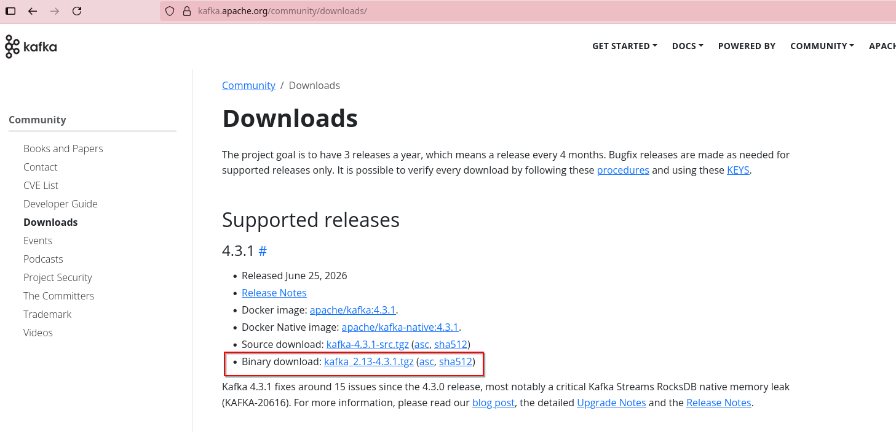

下载后解压，观察目录结构

```bash
daiyinbao@debian13:~/app/kafka/kafka_2.13-4.3.1$ ls -l
总计 516
drwxr-xr-x 3 daiyinbao daiyinbao   4096  6月18日 02:30 bin  --命令文件
drwxr-xr-x 2 daiyinbao daiyinbao   4096  6月18日 02:30 config 
drwxr-xr-x 2 daiyinbao daiyinbao   4096  9月25日 17:19 libs  --Kafka 运行所需的 JAR 包
-rw-r--r-- 1 daiyinbao daiyinbao  14686  6月18日 02:29 LICENSE
drwxr-xr-x 2 daiyinbao daiyinbao   4096  6月18日 02:30 licenses
drwxrwxr-x 2 daiyinbao daiyinbao   4096  9月25日 22:33 logs
-rw------- 1 daiyinbao daiyinbao 455591  9月25日 22:57 nohup.out
-rw-r--r-- 1 daiyinbao daiyinbao  26348  6月18日 02:29 NOTICE
drwxr-xr-x 2 daiyinbao daiyinbao   4096  6月18日 02:30 site-docs
```

### 3、下载检验

```bash
daiyinbao@debian13:~/app/kafka/kafka_2.13-4.3.1$ bin/kafka-topics.sh --version
4.3.1
```

## 三、单机部署kafka

### 1、配置kafka

​	Kafka 4.x 使用 KRaft 模式，不再需要单独启动 ZooKeeper，单机部署直接使用自带的 config/server.properties 就可以，本地测试一般不用修改。

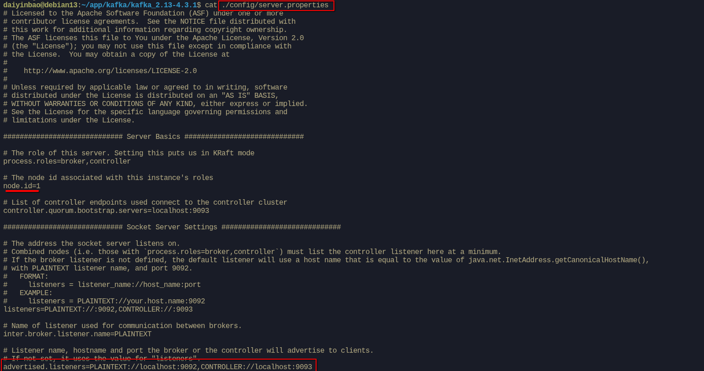

​	如果之后想调整数据存放的位置，可以修改其中的 log.dirs。

### 2、初始化存储目录

第一次启动前需要先初始化一下存储目录。先生成集群 ID：

```bash
daiyinbao@debian13:~/app/kafka/kafka_2.13-4.3.1$ ./bin/kafka-storage.sh --help
usage: kafka-storage [-h] {info,format,version-mapping,feature-dependencies,random-uuid} ...

The Kafka storage tool.

positional arguments:
  {info,format,version-mapping,feature-dependencies,random-uuid}
    info                 Get information about the Kafka log directories on this node.
    format               Format the Kafka log directories on this node.
    version-mapping      Look up the corresponding features for a given metadata version. Using  the  command  with  no  --release-version  argument will return the mapping for the latest stable metadata
                         version
    feature-dependencies
                         Look up dependencies for a given feature version. If the feature is not known or the version not yet defined, an error is thrown. Multiple features can be specified.
    random-uuid          Print a random UUID.  --生成集群 ID

optional arguments:
  -h, --help             show this help message and exit
```

```bash
daiyinbao@debian13:~/app/kafka/kafka_2.13-4.3.1$ bin/kafka-storage.sh random-uuid
CLEZd37CSwqZrzmzF4a2GQ
```


记下输出的 ID，再用它格式化存储目录：

```bash
daiyinbao@debian13:~/app/kafka/kafka_2.13-4.3.1$ ./bin/kafka-storage.sh format -t CLEZd37CSwqZrzmzF4a2GQ -c config/server.properties  --standalone
Bootstrap metadata: BootstrapMetadata(records=[ApiMessageAndVersion(FeatureLevelRecord(name='metadata.version', featureLevel=30) at version 0), ApiMessageAndVersion(FeatureLevelRecord(name='eligible.leader.replicas.version', featureLevel=1) at version 0), ApiMessageAndVersion(FeatureLevelRecord(name='group.version', featureLevel=1) at version 0), ApiMessageAndVersion(FeatureLevelRecord(name='share.version', featureLevel=1) at version 0), ApiMessageAndVersion(FeatureLevelRecord(name='streams.version', featureLevel=1) at version 0), ApiMessageAndVersion(FeatureLevelRecord(name='transaction.version', featureLevel=2) at version 0)], metadataVersionLevel=30, source=format command)
Formatting dynamic metadata voter directory /tmp/kraft-combined-logs with metadata.version 4.3-IV0.
```

### 3、启动kafka

```bash
daiyinbao@debian13:~/app/kafka/kafka_2.13-4.3.1$ bin/kafka-server-start.sh -daemon config/server.properties
```

加上 -daemon 是让 Kafka 在后台运行，去掉它就会在前台启动，可以直接看到日志。

启动之后可以用 jps 看一下进程，能看到 Kafka 就说明启动成功了。

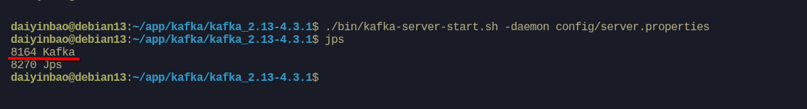

### 4、简单验证

```bash
daiyinbao@debian13:~/app/kafka/kafka_2.13-4.3.1$ ./bin/kafka-topics.sh --help
```

创建一个测试 Topic：

```bash
daiyinbao@debian13:~/app/kafka/kafka_2.13-4.3.1$ bin/kafka-topics.sh --create --topic test --bootstrap-server localhost:9092
```

查看 Topic 列表：

```bash
daiyinbao@debian13:~/app/kafka/kafka_2.13-4.3.1$ bin/kafka-topics.sh --list --bootstrap-server localhost:9092
test
```

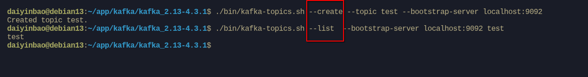

打开一个终端，用控制台生产者发送消息：

```bash
daiyinbao@debian13:~/app/kafka/kafka_2.13-4.3.1$ bin/kafka-console-producer.sh --topic test --bootstrap-server localhost:9092
>hello kafka
```

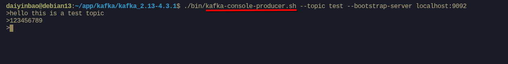

再打开另一个终端，用控制台消费者读取消息：

```bash
daiyinbao@debian13:~/app/kafka/kafka_2.13-4.3.1$ bin/kafka-console-consumer.sh --topic test --bootstrap-server localhost:9092 --from-beginning
hello kafka
```

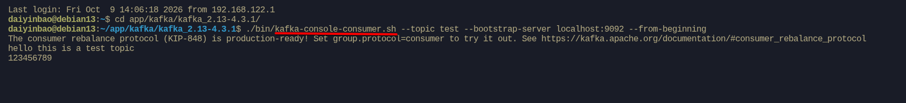

能够收到消息，就说明 Kafka 已经可以正常工作了。

## 四、从单机kafka理解消息队列

前面我们已经把单机 Kafka 跑了起来，这一节就不再讲新的概念，而是用现成的命令，把第一部分里提到的名词亲手验证一遍。

### 1、先发一条、再收一条

先打开一个终端，启动一个消费者，它会一直等着接收消息：

```bash
daiyinbao@debian13:~/app/kafka/kafka_2.13-4.3.1$ bin/kafka-console-consumer.sh --topic test --bootstrap-server localhost:9092
```

再打开另一个终端，启动生产者并发送一条消息：

```bash
daiyinbao@debian13:~/app/kafka/kafka_2.13-4.3.1$ bin/kafka-console-producer.sh --topic test --bootstrap-server localhost:9092
>你好，Kafka
```

回到消费者的终端，就能看到刚刚发出的消息：

```text
你好，Kafka
```

一条消息就这样从生产者出发，经过 Kafka，被消费者收到。第一部分里说的生产者、消费者，到这里就变成了看得见的操作。

需要注意，**消费者默认只接收启动之后产生的新消息**，所以要先启动消费者，再发送消息。

我们反过来试一下。先在生产者里发一条消息：

```bash
daiyinbao@debian13:~/app/kafka/kafka_2.13-4.3.1$ bin/kafka-console-producer.sh --topic test --bootstrap-server localhost:9092
>这条消息先发出去了
```

然后再启动消费者：

```bash
daiyinbao@debian13:~/app/kafka/kafka_2.13-4.3.1$ bin/kafka-console-consumer.sh --topic test --bootstrap-server localhost:9092
```

这时消费者这边一直空着，什么也没收到。因为这条消息是在它启动之前发出去的，而消费者默认从"当前最新的位置"开始读，所以错过了之前已经存在的消息。

那如果就是要读之前的消息呢？启动消费者时加上 **--from-beginning** 就可以：

```bash
daiyinbao@debian13:~/app/kafka/kafka_2.13-4.3.1$ bin/kafka-console-consumer.sh --topic test --from-beginning --bootstrap-server localhost:9092
```

这次就能看到之前发送的消息：

```text
你好，Kafka
这条消息先发出去了
```

可以看到，--from-beginning 表示从这个 Topic 最早的消息开始读，所以历史消息也会一起读出来。

### 2、消息按 Topic 分类

Kafka 里的消息不会混在一起，而是按 Topic 分开存放。我们可以新建一个自己的 Topic：

```bash
daiyinbao@debian13:~/app/kafka/kafka_2.13-4.3.1$ bin/kafka-topics.sh --create --topic test2 --bootstrap-server localhost:9092
```

再查看一下当前的 Topic 列表：

```bash
daiyinbao@debian13:~/app/kafka/kafka_2.13-4.3.1$ bin/kafka-topics.sh --list --bootstrap-server localhost:9092
test
test2
```

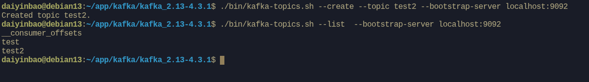

可以看到，前面用过的 test 和刚创建的 hello 都在这里。Topic 就像是不同的"频道"，订单消息发到订单的频道，日志发到日志的频道，互不干扰。

### 3、同一份消息，多个消费者组都能读

Kafka 允许**多个消费者组订阅同一个 Topic**。我们启动两个消费者，分别属于 group-a 和 group-b：

```bash
# 终端 A
daiyinbao@debian13:~/app/kafka/kafka_2.13-4.3.1$ bin/kafka-console-consumer.sh --topic test --group group-a --bootstrap-server localhost:9092

# 终端 B
daiyinbao@debian13:~/app/kafka/kafka_2.13-4.3.1$ bin/kafka-console-consumer.sh --topic test --group group-b --bootstrap-server localhost:9092
```

然后在第三个终端里再发送一条消息：

```bash
daiyinbao@debian13:~/app/kafka/kafka_2.13-4.3.1$ bin/kafka-console-producer.sh --topic test --bootstrap-server localhost:9092
>订单已创建
```

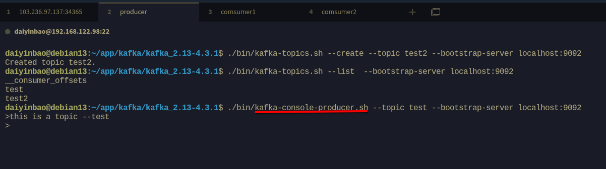

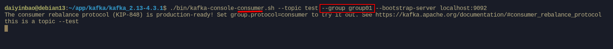

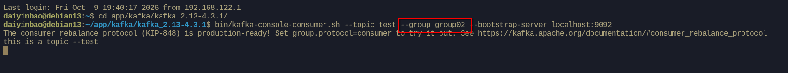

这时你会发现，终端 A 和终端 B 都收到了这条消息。这正是第一部分说的"一份数据，多个业务各取所需"：订单服务、通知服务、数据同步服务可以各自订阅，互不影响，也就降低了系统之间的耦合。

### 4、消息读完不会立刻消失

在第 1 节里我们其实已经见过一个现象：消费者读走消息之后，用 --from-beginning 还能把它重新读出来。这说明消费者读取消息，并不会把消息从 Kafka 里删掉。

**Kafka 会把消息按顺序写入分区对应的日志文件中保存起来**，消息保存多久、什么时候清理，由 Topic 的保留策略决定。默认情况下，消息会保留一段时间，只要还在保留范围内，就可以被再次读取。

这也是 Kafka 和很多传统队列不太一样的地方：传统队列往往是"消费即删除"，而 **Kafka 允许同一份消息被多个消费者组分别读取，也允许在需要的时候重新读取**。日志回放、数据补算，以及把历史数据重新灌入下游系统，都是基于这个特点实现的。

需要注意，消息并不是永久保存的。一旦超过保留时间或者超过存储上限，旧消息就会被清理掉，这时候就没法再读了。

### 5、消息的"座位号"：Offset

既然消息会被保存，Kafka 就需要记录每个消费者组读到哪儿了，这个位置就是 Offset。我们可以**查看 group-a 的消费进度**：

```bash
daiyinbao@debian13:~/app/kafka/kafka_2.13-4.3.1$ bin/kafka-consumer-groups.sh --describe --group group02 --bootstrap-server localhost:9092
Consumer group 'group02' has no active members.
GROUP    TOPIC   PARTITION  CURRENT-OFFSET  LOG-END-OFFSET  LAG    CONSUMER-ID   HOST       CLIENT-ID
group02   test       0          3               8            5         -           -            -
```

输出大致如下：

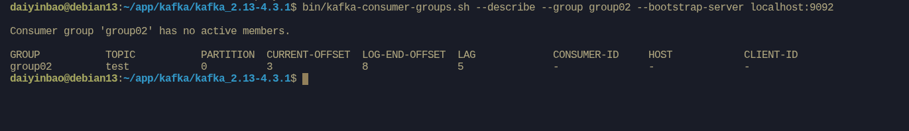

- CURRENT-OFFSET：这个消费者组当前读到的位置。
- LOG-END-OFFSET：这个分区最新消息的位置。
- LAG：两者相差多少，也就是还有多少消息没有被消费。

**当 LAG 一直增长时，就说明消费速度跟不上生产速度，出现了消息积压。**

### 6、分区：并行与顺序

一个 Topic 还可以拆成多个分区。我们新建一个带 3 个分区的 Topic：

```bash
daiyinbao@debian13:~/app/kafka/kafka_2.13-4.3.1$ bin/kafka-topics.sh --create --topic orders --partitions 3 --bootstrap-server localhost:9092
```

查看它的详情：

```bash
daiyinbao@debian13:~/app/kafka/kafka_2.13-4.3.1$ bin/kafka-topics.sh --describe --topic orders --bootstrap-server localhost:9092
```

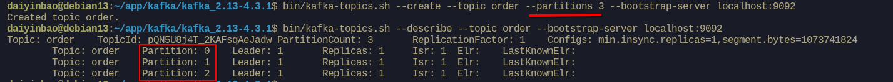

可以看到这个 Topic 有 3 个分区（Partition 0、1、2）。分区带来两个好处：**同一个消费者组里最多可以有 3 个消费者并行读取**；同时，Kafka 只保证**单个分区内的消息有序**，同一个订单的消息如果用订单 ID 作为 Key，就会落到同一个分区，从而保证处理顺序。

### 7、回到 MQ 的四个作用

把上面的实验串起来，第一部分说的几个作用就都能对应上了：

- 异步处理：生产者发完消息就可以返回，不必等待消费者处理完。
- 应用解耦：消费者组各自订阅，生产者和消费者之间不需要直接调用。
- 流量削峰：突发消息可以先堆在 Kafka 里，由消费者按照自己的处理能力慢慢消费。
- 消息缓冲与重放：消息被保存下来，消费者进度不一致时也能各自读取，必要时还能重读。

### 小结

这一节我们没有引入新的概念，只是用几条命令把生产者、消费者、Topic、分区、Offset 和消费者组跑了一遍。理解了这些，再去写生产者、消费者的代码，就会顺很多。

